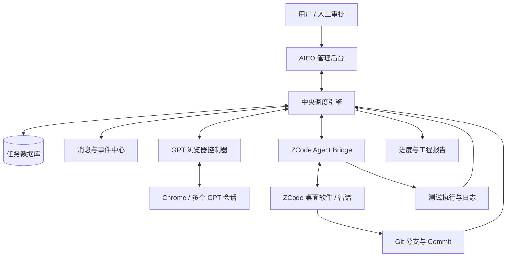

# AIEO 总体架构设计

**版本：** v0.1  
**状态：** 立项设计  
**部署策略：** Windows 单机优先，预留局域网多节点  
**核心原则：** GPT 管理工程，智谱实施工程，Git 保存交付证据，AIEO 管理任务和质量。

## 1. 项目目标

建设一套 AI 软件工程协同管理系统，使用户只需提交开发需求，系统即可尽可能自动完成：

1. 读取项目知识库和代码基线；
2. GPT 项目经理分析需求、拆分任务；
3. GPT 架构师审核方案；
4. AIEO 按依赖关系调度任务；
5. ZCode/智谱领取任务、开发、测试并提交 Git；
6. GPT 代码审查员检查真实 Git Diff；
7. GPT 测试验收员检查测试证据并补充验证；
8. GPT 总审计员汇总开发批次；
9. AIEO 更新进度、输出报告；
10. 需要主分支合并、生产发布或重大决策时交由用户审批。

## 2. 已确认运行环境

| 项目 | 确认值 |
|---|---|
| 开发执行软件 | Windows 上的 ZCode 桌面软件 |
| 开发模型 | 智谱，通过 ZCode 使用 |
| GPT 管理端 | Windows Chrome，多个 GPT 会话 |
| 自动化程度 | 尽可能全自动，异常时人工介入 |
| 首期部署 | 一台 Windows 电脑 |
| 后续扩展 | 局域网 Worker 节点 |
| 代码管理 | Git，具体 GitHub/自建远程仓库按项目配置 |
| 工程标准 | 用户已制定的七大软件工程规范 |

## 3. 总体逻辑架构



所有执行端只与中央调度引擎交互。GPT 控制器和 ZCode Bridge 不直接互相调用，避免形成难以追踪的点对点依赖。

## 4. 系统模块

### 4.1 管理后台

职责：
- 项目列表、项目详情；
- 需求录入；
- 任务树、依赖图、看板；
- Agent/会话状态；
- Git Commit、Diff 和分支信息；
- 测试报告、审查报告；
- 人工审批、暂停、恢复和取消；
- 进度与批次总结。

首期前端建议 Vue 3 + TypeScript。

### 4.2 中央后端与调度引擎

职责：
- 提供 REST API；
- 管理任务状态机；
- 维护任务依赖；
- 管理 Agent 分配和租约；
- 接收并校验消息；
- 处理重试、超时和人工介入；
- 计算进度；
- 生成报告。

首期建议 Python + FastAPI。后台任务先使用数据库持久化队列/轮询调度，确认有并发压力后再引入 Redis。

### 4.3 GPT 浏览器控制器

职责仅限：
- 启动/连接专用 Chrome 配置；
- 定位配置好的 GPT 会话；
- 发送角色任务包；
- 检测回复是否结束；
- 提取回复；
- 校验结构化输出；
- 将结果提交给 AIEO。

不负责任务数据库、Git 操作、代码修改或进度计算。

技术建议：Playwright。首期优先由 Playwright 启动独立浏览器配置目录；不要依赖用户日常 Chrome 配置。登录由用户手动完成，认证状态保存在本机受保护的用户目录中。

限制：
- ChatGPT 网页不是可任意操控多个会话的通用官方 Agent API；
- 网页结构、登录状态、验证码、安全检查可能变化；
- 不使用逆向私有接口或绕过安全验证；
- 出现验证、登录失效或页面不确定时暂停并请求人工接管；
- 同一 GPT 会话同一时刻只允许一个在途任务。

### 4.4 ZCode Agent Bridge

职责：
- 接收 AIEO 派发的任务；
- 在 ZCode 中触发/关联开发会话；
- 向 ZCode 提供任务上下文；
- 通过 MCP 让智谱主动读取任务、规范和报告要求；
- 获取开发状态、完成报告；
- 校验 Git 分支、Commit、测试日志；
- 回传 AIEO。

首选接入顺序：
1. 验证 ZCode 当前版本支持的 MCP 配置和工具调用；
2. 验证是否有受支持的外部任务启动方式；
3. 若不能外部启动，验证 Bot Channel 是否适用；
4. 最后才考虑 Windows UI Automation/pywinauto 作为 GUI 适配器。

**重要边界：** MCP Server 能被 ZCode Agent 调用，不代表外部程序可以通过 MCP 直接启动一个新的 ZCode 会话。必须分别验证“Agent 调用工具”和“外部启动 Agent”两项能力。

### 4.5 Git Worker

职责：
- 检查仓库路径和工作区状态；
- 创建任务分支；
- 读取 Commit 和 Diff；
- 记录 Commit SHA；
- 验证提交是否属于当前任务分支；
- 生成审查包；
- 保护 main/master 分支。

首期可通过 Git CLI 实现。GitHub API 作为远程 PR、状态和仓库元数据的补充。

### 4.6 质量引擎

将七大软件工程规范转化为任务模板、检查清单和验收规则：
1. 需求分析；
2. 架构设计；
3. 开发实施；
4. 代码质量；
5. 测试验收；
6. 项目收尾；
7. Git 提交与版本管理。

每个任务需要标记适用项和不适用项。不适用时填写理由，避免小改动被迫执行不必要的重型流程。

## 5. 单机部署结构

建议目录：

```text
C:\AIEO\
├── app\
│   ├── backend\
│   ├── frontend\
│   ├── workers\
│   │   ├── gpt_browser\
│   │   ├── zcode_bridge\
│   │   ├── git_worker\
│   │   └── test_worker\
│   ├── mcp\
│   │   └── aieo_mcp_server\
│   ├── contracts\
│   ├── prompts\
│   └── tests\
├── runtime\
│   ├── database\
│   ├── artifacts\
│   ├── logs\
│   ├── screenshots\
│   └── chrome_profiles\
└── projects\
    └── <registered-projects>\
```

代码目录与运行数据目录分离。运行数据、浏览器登录配置、日志和项目工作区不得误提交到 AIEO 源码仓库。

## 6. 首期技术选型

| 层 | 建议 |
|---|---|
| 前端 | Vue 3 + TypeScript |
| 后端 | Python + FastAPI |
| 数据库 | SQLite 起步，PostgreSQL 迁移预留 |
| 任务调度 | 数据库持久化任务队列 |
| 浏览器 | Playwright |
| Windows GUI | pywinauto / Windows UI Automation，仅兜底 |
| ZCode 接入 | MCP 优先，外部启动方式需 POC |
| Git | Git CLI，必要时 GitHub API |
| 实时状态 | WebSocket |
| 本地进程管理 | Windows 登录后启动的用户态进程管理器 |

Redis 不作为首期硬依赖。出现多 Worker、高并发或队列吞吐需求后再引入。

## 7. Windows 桌面自动化运行边界

浏览器和 ZCode 属于交互式桌面程序，不应仅依赖 Windows Service 控制。桌面自动化进程应在已登录的 Windows 用户会话中运行。

建议：
- FastAPI 可作为后台进程或服务；
- GPT Browser Worker 与 ZCode Bridge 由 Windows 任务计划程序在用户登录后启动；
- 锁屏、注销、睡眠和远程桌面会话切换均纳入稳定性测试；
- 用户退出登录时，Worker 应将状态标记为 OFFLINE/PAUSED；
- 不把 Chrome 调试端口暴露到局域网；
- 管理 API 首期仅绑定 `127.0.0.1`。

## 8. 多电脑扩展

首期所有模块同机运行，但从接口上预留 Worker 节点：

```text
AIEO Central
  ├── Worker Windows-A (ZCode)
  ├── Worker Windows-B (ZCode)
  └── Worker Linux-C (测试/脚本)
```

每个 Worker 注册：
- worker_id；
- OS；
- 可用执行器；
- 可访问项目；
- 当前负载；
- 在线状态；
- 软件版本。

Worker 通过 HTTPS/WebSocket 与中央节点通信。多机阶段再迁移 PostgreSQL、Redis，并增加节点认证和权限隔离。

## 9. 非目标与禁止事项

首期不做：
- 自动生产发布；
- 自动合并主分支；
- 未经批准的数据库破坏性迁移；
- 绕过 ChatGPT 登录或安全验证；
- 逆向 ZCode 私有协议；
- 同一工作区多个 Agent 无协调地并发写入；
- 先建设复杂分布式架构。

## 10. 架构决策记录

| 编号 | 决策 | 原因 |
|---|---|---|
| ADR-001 | Windows 单机优先 | 降低部署复杂度 |
| ADR-002 | GPT 网页与 ZCode 使用独立适配器 | 两者技术边界不同 |
| ADR-003 | 所有消息经过中央调度 | 可追踪、可重试、可审计 |
| ADR-004 | Git Commit 是代码审查基准 | 确保审查对象确定 |
| ADR-005 | MCP 优先接入 ZCode | 避免纯 GUI 自动化 |
| ADR-006 | 外部启动 ZCode 必须 POC | 不把 MCP 能力误认为启动 API |
| ADR-007 | SQLite 起步 | 单机低运维成本 |
| ADR-008 | 主分支与生产发布人工审批 | 降低自动化风险 |
