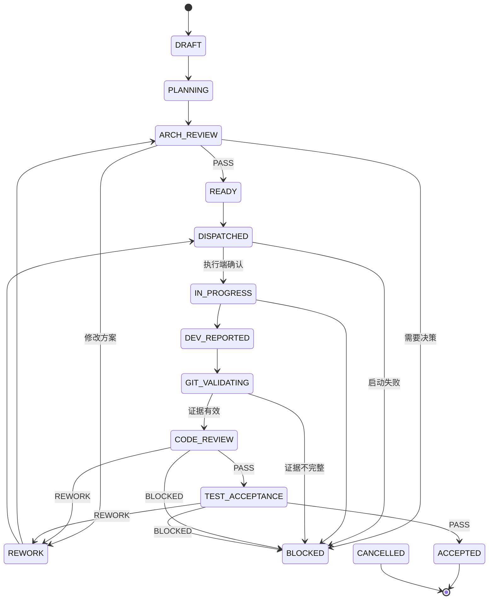

# AIEO 任务状态机、数据库与 Git 规范

**版本：** v0.1

## 1. 任务状态机

建议状态：

| 状态 | 含义 |
|---|---|
| `DRAFT` | 草稿 |
| `PLANNING` | GPT 需求分析/拆解中 |
| `ARCH_REVIEW` | 等待架构审核 |
| `READY` | 依赖满足，等待开发 |
| `DISPATCHED` | 已派发，等待执行端确认 |
| `IN_PROGRESS` | 开发中 |
| `DEV_REPORTED` | 开发端已提交完成报告 |
| `GIT_VALIDATING` | 系统验证 Git 和证据 |
| `CODE_REVIEW` | GPT 代码审查中 |
| `TEST_ACCEPTANCE` | 测试验收中 |
| `REWORK` | 需要返工 |
| `BLOCKED` | 阻塞，等待处理 |
| `ACCEPTED` | 任务验收通过 |
| `CANCELLED` | 已取消 |

## 2. 状态流转



任务返工时创建新的 `execution_id` 和返工轮次，保留原始任务、Commit 和审查历史。不得覆盖历史报告。

## 3. 状态控制规则

- 只能由 AIEO 状态机修改正式任务状态；
- Agent 只能提交事件/报告，不能自行把任务改为 ACCEPTED；
- `BLOCKED` 必须包含原因、责任方和解除条件；
- `ACCEPTED` 必须有代码审查和测试验收证据；
- 被修改的 Commit 必须重新审查；
- 超时先查询执行端、进程、工作区和 Git，不可盲目重复派发；
- 取消任务必须记录操作者和原因。

## 4. 进度计算

任务完成率：

```text
完成率 = ACCEPTED 任务权重之和 / 全部有效任务权重之和 × 100%
```

首期默认所有任务权重相同。以后可按任务复杂度设置权重，但必须在开发开始前确定。

以下状态不计为完成：
- IN_PROGRESS；
- DEV_REPORTED；
- GIT_VALIDATING；
- CODE_REVIEW；
- TEST_ACCEPTANCE；
- REWORK；
- BLOCKED。

同时显示任务数量统计，避免单一百分比掩盖阻塞任务。

## 5. 数据库核心实体

首期至少需要：

| 表 | 核心字段 |
|---|---|
| `projects` | id, name, status, knowledge_version |
| `repositories` | id, project_id, url, local_path, default_branch |
| `batches` | id, project_id, requirement, status |
| `tasks` | id, batch_id, parent_id, title, description, status, priority |
| `task_dependencies` | task_id, depends_on_task_id |
| `task_executions` | id, task_id, agent_id, attempt, started_at, ended_at |
| `agents` | id, type, role, enabled, capabilities |
| `agent_sessions` | id, agent_id, session_url, profile_key, status |
| `messages` | message_id, type, source, target, payload, status |
| `artifacts` | id, task_id, type, path, sha256 |
| `git_commits` | id, task_id, repository_id, branch, sha |
| `development_reports` | id, execution_id, payload, created_at |
| `review_reports` | id, task_id, reviewed_commit, result, payload |
| `test_reports` | id, task_id, commit_sha, result, payload |
| `approvals` | id, target_type, target_id, decision, actor |
| `audit_logs` | id, actor, action, target, timestamp |

数据库设计需支持迁移，业务逻辑不能依赖 SQLite 特有行为。

## 6. Git 规范

### 分支

```text
main
feature/<TASK-ID>-<short-name>
fix/<TASK-ID>-<short-name>
```

### 基本规则

1. 每个代码任务独立分支；
2. 开发前记录基线 Commit；
3. 不允许智谱直接向 main 提交；
4. 开发完成后提交 Commit SHA；
5. AIEO 独立读取 Git Diff；
6. GPT 审查必须绑定明确 Commit SHA；
7. 测试报告必须绑定测试代码对应的 Commit；
8. 返工后生成新的 Commit，旧审查结论失效；
9. 合并主分支必须人工审批；
10. 发布生产环境必须人工审批。

### 并发策略

首期默认同一仓库一个代码写入任务。

经过验证后可用 Git Worktree 并行，但必须满足：
- 文件范围不冲突；
- 数据库/API 契约已确定；
- 每个任务独立分支和工作目录；
- 集成任务负责解决冲突；
- 不允许多个 Agent 同时写同一个工作目录。

## 7. 工程规范版本

每个批次和任务固定：
- `engineering_standard_version`；
- `knowledge_base_commit`；
- `repository_base_commit`；
- `task_package_hash`。

工程规范或任务包更新后，必须生成新版本，不得静默覆盖已派发任务的要求。
